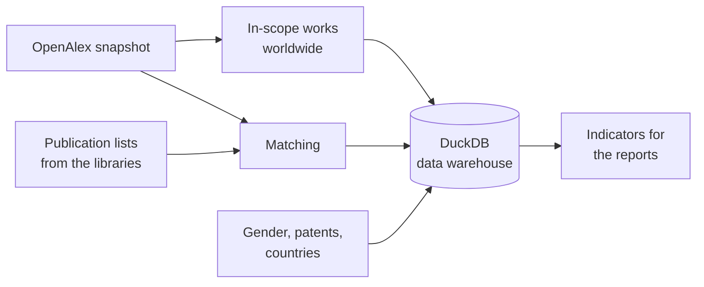

# Open Bibliometric Study of the ETH Domain (2014–2023)

This repository contains the code used to build the data warehouse behind the bibliometric reports of the six ETH Domain institutions (ETH Zurich, EPFL, PSI, WSL, Empa, Eawag), produced jointly by EPFL and ETH Zurich for the ETH Board.

In short, the pipeline:

1. **downloads a snapshot of [OpenAlex](https://openalex.org)**, the open bibliographic database used as the single data source;
2. **filters out works that are not in scope** (see [Scope](#scope));
3. **matches the publication lists provided by the institutions' libraries** to OpenAlex works;
4. **adds metrics that OpenAlex does not provide** (author gender, patent citations, …);
5. **builds a DuckDB data warehouse** with the key indicators used in the reports (normalised citation impact, top 10% publications, open access, collaboration, gender, …).



The reports themselves are generated from this DuckDB in a separate repository.

## Why publication lists from the libraries?

OpenAlex links works to institutions through author affiliations, which can be incomplete or inaccurate. Instead of relying on them, we asked each institution's library to provide the list of publications to evaluate. This let each institution **control exactly which publications were included in its evaluation**. OpenAlex is then used to retrieve consistent metadata and citations for these publications, and the matching step links each listed publication to its OpenAlex work.

## Important: snapshot version

The OpenAlex snapshot was **downloaded in summer 2025 (3 September 2025)**, and the code was written for the snapshot format of that time. OpenAlex evolves continuously, so a newer snapshot may have a different schema or content: **we cannot guarantee that the code works as-is with the latest snapshot**, and results computed on a newer snapshot will differ from those in the reports.

## Data is not included

This repository contains code only. In particular, it does **not** include:

- the OpenAlex snapshot (~420 GB) or any data derived from it (Parquet, DuckDB);
- the publication lists provided by the libraries (EPFL, ETH Zurich, PSI, WSL, Empa, Eawag);
- the gender cache built from the Genderize API;
- the patent–paper pairs from [Reliance on Science](https://relianceonscience.org/patent-paper-pairs).

## Scope

A work from the snapshot is included in the analysis only if all of the following hold: it is in English, has at least one authorship with an institution, has an OpenAlex subfield, has references, is published in a *core* source or is a proceedings article, is not retracted, and is not paratext. The decision and each individual condition are stored for every work in `core.work_to_status`.

The filter is applied to all works worldwide, not only to those of the ETH Domain, because citation impact is normalised against all in-scope works with the same publication year, subfield and type (proceedings article or not).

## Repository structure

| Folder | Step |
| --- | --- |
| [`eth_domain_2025/1_data`](eth_domain_2025/1_data) | Download the OpenAlex snapshot and convert works to Parquet for matching |
| [`eth_domain_2025/2_matches`](eth_domain_2025/2_matches) | Match each library's publication list to OpenAlex works |
| [`eth_domain_2025/3_dwh`](eth_domain_2025/3_dwh) | Build the DuckDB data warehouse, add gender and patents, compute the metrics |
| [`modules`](modules) | Reusable code: OpenAlex snapshot reader and publication matching |

Each folder has a README describing its scripts, which are numbered in execution order.

## Running the pipeline

Requirements: Python 3.12, about 700 GB of free disk space, and a large-memory machine (the DuckDB steps were run with 32–36 GB of memory).

```bash
python -m venv .venv && source .venv/bin/activate
pip install -r requirements.txt
cp .env.example .env               # then add your Genderize API key
export PYTHONPATH="$(pwd)"         # scripts import from modules/
```

Scripts are run from their own folder (paths are relative), in this order: `1_data`, then `2_matches`, then `3_dwh/1_build`. The library publication lists must be placed in `eth_domain_2025/2_matches/<institution>/input/` beforehand.

## License

The code is released under the [MIT License](LICENSE). The data sources keep their own terms: OpenAlex data is CC0, and the Reliance on Science and Genderize.io terms apply to their data.
