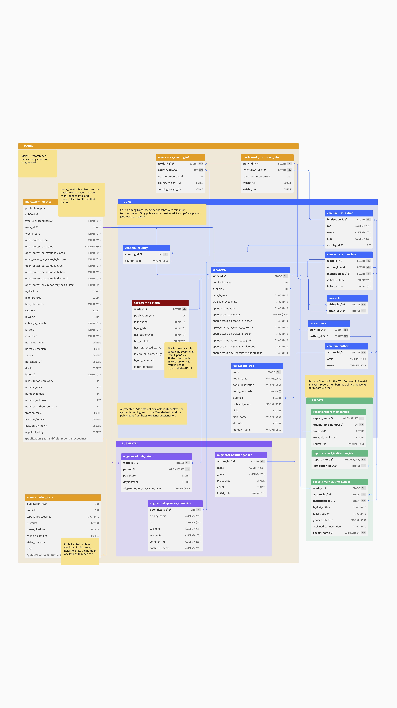

# Data warehouse schema

Tables of the DuckDB data warehouse, grouped by schema: `core` (OpenAlex, in-scope works), `augmented` (external data: gender, patents, countries), `marts` (pre-computed metrics) and `reports` (ETH Domain publication lists). A [PDF version](diagram.pdf) is also available. The diagram was made with [dbdiagram.io](https://dbdiagram.io/d/69142bb46735e1117062e77e).

