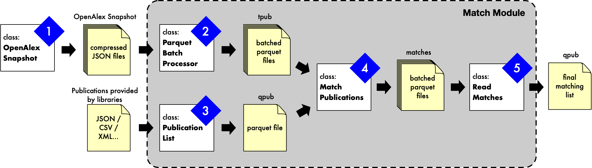

# Match

This module finds the publications of a list (e.g. provided by a library) in the OpenAlex snapshot. Some matches are straightforward (same DOI or OpenAlex ID), others rely on fuzzy title matching confirmed by the journal and the authors. Because the snapshot has tens of millions of works, the matching works on Parquet batches processed in parallel, with inverted indexes rather than pairwise comparisons.

Vocabulary: **qpub** are the *query* publications (the list to match) and **tpub** the *target* publications (OpenAlex works).



## 1. Prepare the OpenAlex works (tpub)

Download the snapshot with [`openalex_snapshot`](../openalex_snapshot/README.md), then convert the works to Parquet batches that keep only the fields needed for matching:

```python
from modules.match.ParquetBatchProcessor import ParquetBatchProcessor

processor = ParquetBatchProcessor(
    input_dir="path/to/snapshot",        # downloaded snapshot
    output_dir="path/to/tpub",           # must not exist yet
    batch_size=100_000,                  # works per Parquet file
    start_year=2013, end_year=2024,      # works outside this range are skipped
)
processor.process()
```

## 2. Prepare the publication list (qpub)

`PublicationList` validates a pandas DataFrame and writes it to Parquet. Required columns: `title`, `internal_id`, `dois`, `openalex_id`, `year`, `publication_type`, `authors_all`, `journal`. List columns (`dois`, `authors_all`, …) may be lists or strings such as `"['a', 'b']"`. OpenAlex IDs must be numeric (`W123` → `123`). An `original_line_number` column is added to keep the original order.

```python
import pandas as pd
from modules.match.PublicationList import PublicationList

df = pd.read_csv("list.csv")
df = df.rename(columns={"doi": "dois"})
df["openalex_id"] = df["openalex_id"].str.replace("W", "", regex=False).astype(float)
PublicationList(df, "path/to/qpub.parquet")   # raises an error if the format is wrong
```

## 3. Discover candidate matches

`MatchPublications` applies a set of metrics to every tpub batch. Each metric returns a boolean tpub × qpub matrix; a pair is saved as a candidate when the weighted sum of its metrics reaches the threshold.

```python
from modules.match.Match import MatchPublications
from modules.match.Metrics import MetricOpenAlexID, MetricTitleSimhash, MetricDoiMatch

matcher = MatchPublications("path/to/qpub.parquet", "path/to/tpub", "path/to/matches", max_workers=2)
matcher.add_metrics(MetricOpenAlexID())
matcher.add_metrics(MetricDoiMatch())
matcher.add_metrics(MetricTitleSimhash(k=3, f=128, min_length=12, ngram_size=2))
matcher.run(threshold=1, weights={"openalex_id_match": 1.0, "doi_match": 1.0, "title_simhash": 1.0})
```

Candidates are written to `path/to/matches/parquets/`, with all qpub columns (`qpub_*`), all tpub columns (`tpub_*`) and one column per metric (`metric_*`). Other metrics are available in [`Metrics.py`](Metrics.py), e.g. exact journal title, author similarity (MinHash) or affiliation to an institution.

## 4. Score and select the best match

`ReadMatch` loads the candidates, and priority scores from [`PriorityScore.py`](PriorityScore.py) add one column each:

| Score | Meaning |
| --- | --- |
| `TitleSimilarity` | 1 − normalized Damerau-Levenshtein distance between titles |
| `JournalSimilarity` | Same, between the journal names |
| `AuthorsSimilarity` | Same, between the sorted lists of simplified author names |
| `RareTitle` | True if the title occurs at most `max_occurence` times in the snapshot (counts are cached) |

```python
from modules.match.Match import ReadMatch
from modules.match.PriorityScore import TitleSimilarity, RareTitle, JournalSimilarity, AuthorsSimilarity

match = ReadMatch("path/to/matches/parquets")
for score in [TitleSimilarity(), RareTitle("path/to/tpub"), JournalSimilarity(), AuthorsSimilarity()]:
    match.add_priority_score(score)
candidates = match.df   # filter and rank these rows to keep one match per qpub
```

The filtering and ranking used in the ETH Domain study are in [`03_pick_best_matches.py`](../../eth_domain_2025/2_matches/03_pick_best_matches.py).

To inspect candidates, `match.investigate(boolean_filter, limit=20)` prints side-by-side titles, authors, DOIs and journals of random candidates.

## Adding a metric

Subclass `Metric` in [`Metrics.py`](Metrics.py) and implement:

- `load_qpub(path_qpub)`: called once; build `self.query` (e.g. an inverted index of the query publications);
- `apply(path_tpub, name_tpub)`: called for each tpub batch; set `self.match_matrix` to a boolean sparse matrix of shape `(n_tpub, n_qpub)`.

`MetricOpenAlexID` is the simplest example. Avoid nested loops over qpub and tpub: a list of 200,000 publications against tens of millions of works means trillions of pairs.
